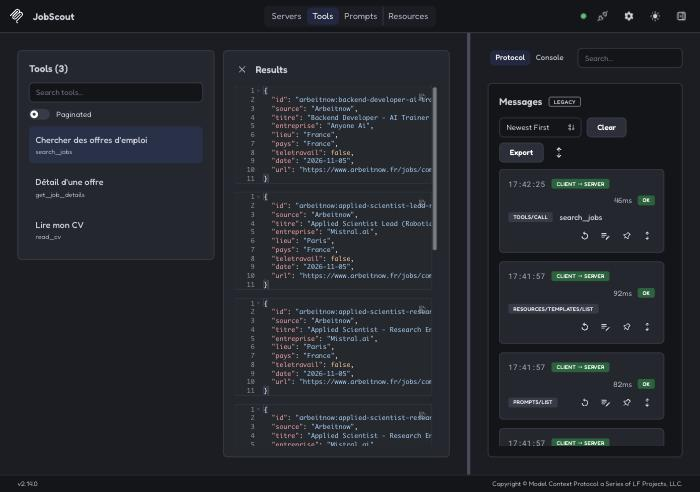

# JobScout MCP


Un serveur **MCP** (Model Context Protocol) qui donne à n'importe quel assistant IA compatible
(Claude Desktop, l'inspecteur MCP, d'autres clients) les outils de recherche d'emploi de
[JobScout](https://github.com/T-R-Bama/JobScout) : chercher des offres, lire leur détail, lire le CV
pour comparer.

Dans JobScout, j'avais écrit ma propre boucle d'agent : je décrivais les outils au modèle et
j'exécutais ses demandes. Ici, je ne fournis **que les outils** ; c'est l'assistant qui décide quand
s'en servir. Les mêmes outils marchent donc avec n'importe quel modèle et n'importe quelle
application qui parle MCP, sans une ligne de code de plus.

## Les outils exposés

| Outil | Ce qu'il fait |
|---|---|
| `search_jobs` | Cherche des offres sur Arbeitnow (Europe, dont la France) et Remotive (télétravail), plus Adzuna (France) si ses clés sont fournies. Filtres : lieu (ville ou pays), télétravail, nombre de résultats (1 à 10). Renvoie le vrai lien de chaque offre. |
| `get_job_details` | Détail complet d'une offre (description, tags, salaire) à partir de son id. |
| `read_cv` | Texte du CV de l'utilisateur (PDF, `.md` ou `.txt`). |

Plus un **prompt** prêt à l'emploi, `offres_pour_mon_cv` : « lis mon CV, cherche des offres qui me
correspondent, compare les 3 meilleures ».

Tous les outils sont annotés « lecture seule » : ils ne modifient rien.

## Installation

Il faut Python 3.13.

```bash
git clone https://github.com/T-R-Bama/jobscout-mcp.git
```

```bash
cd jobscout-mcp
```

```bash
python3.13 -m venv .venv
```

```bash
.venv/bin/pip install -r requirements-dev.txt
```

Facultatif : copier `.env.example` en `.env` pour indiquer le chemin du CV (`CV_PATH`) et les clés
Adzuna. Le CV par défaut est `data/cv.pdf` ; il n'est jamais publié (voir `.gitignore`).

## Lancer les tests

```bash
.venv/bin/python -m pytest -v
```

Les tests n'utilisent ni Internet ni LLM : les offres sont fictives et le réseau est bloqué. Ils
parlent au serveur avec le vrai client MCP du SDK, dans le même processus, et un test lance
`serveur.py` en sous-processus exactement comme Claude Desktop. Ils tournent aussi sur GitHub
Actions à chaque envoi de code.

## Essayer avec l'inspecteur MCP

L'[inspecteur MCP](https://github.com/modelcontextprotocol/inspector) officiel est une page web qui
se connecte au serveur et permet d'appeler chaque outil à la main. Il demande
[Node.js](https://nodejs.org) (version LTS).

Depuis le dossier du projet :

```bash
npx @modelcontextprotocol/inspector .venv/bin/python serveur.py
```

La page s'ouvre dans le navigateur : cliquer sur **Connect**, puis **Tools → List Tools**, choisir
`search_jobs`, remplir `mots_cles` (par exemple `python developer`) et cliquer sur **Execute Tool**.



## Brancher sur Claude Desktop

1. Trouver le chemin complet du dossier du projet : dans le terminal, depuis le dossier, taper `pwd`.
2. Dans Claude Desktop : **Réglages → Développeur → Modifier la configuration**. Cela ouvre le
   fichier `claude_desktop_config.json`.
3. Y mettre ce bloc, en remplaçant les deux `CHEMIN_DU_PROJET` par le résultat de `pwd` (et le
   chemin du CV par le tien, ou retirer la partie `env`) :

   ```json
   {
     "mcpServers": {
       "jobscout": {
         "command": "CHEMIN_DU_PROJET/.venv/bin/python",
         "args": ["CHEMIN_DU_PROJET/serveur.py"],
         "env": { "CV_PATH": "CHEMIN_DU_PROJET/data/cv.pdf" }
       }
     }
   }
   ```

   Si le fichier contient déjà un bloc `mcpServers`, ajouter seulement l'entrée `"jobscout": {…}`
   à l'intérieur.
4. Quitter complètement Claude Desktop (Cmd + Q) puis le rouvrir.
5. Dans une conversation, l'icône des outils doit montrer `jobscout` avec ses 3 outils. Essayer :
   « Trouve-moi 3 offres de développeur Python à Paris ou en télétravail ».

En cas de souci, les journaux du serveur sont dans `~/Library/Logs/Claude/mcp-server-jobscout.log`.

## Organisation du code

```
serveur.py               point d'entrée (lancé par Claude Desktop ou l'inspecteur)
jobscout_mcp/serveur.py  déclaration des outils et du prompt MCP
jobscout_mcp/offres.py   recherche d'offres et lecture du CV, reprises de JobScout
jobscout_mcp/config.py   configuration (.env, chemins absolus)
tests/                   tests sans réseau ni LLM
```

`offres.py` est une copie adaptée de `agent/outils.py` de JobScout : le projet reste autonome et
JobScout n'est pas modifié.

## Ce que ce projet m'a appris

- **MCP sépare les outils de l'agent.** Dans JobScout, j'écrivais à la main les schémas JSON des
  outils et la boucle qui les exécute. Avec le SDK MCP officiel (`MCPServer`, anciennement
  FastMCP), le schéma est déduit de la signature Python et de la docstring, et la boucle est celle
  du client.
- **En transport stdio, la sortie standard appartient au protocole.** Un seul `print()` dans le
  serveur casse la communication avec le client.
- **Les erreurs prévues doivent être lisibles par le modèle.** Une `ToolError` arrive au client comme
  un résultat en erreur avec un message clair (« CV introuvable, indique CV_PATH », « site d'offres
  injoignable ») ; une exception quelconque ne donne qu'un « Error executing tool ».
- **Le client lance le serveur depuis n'importe quel dossier.** Tous les chemins (CV, cache, `.env`)
  sont donc calculés à partir de l'emplacement du code, jamais du dossier courant.
- **On peut tester un protocole sans réseau.** Le client du SDK se connecte au serveur dans le même
  processus : les tests vérifient les vrais échanges MCP (liste des outils, schémas, appels,
  erreurs) en moins d'une seconde.

## Sources des offres

- [Arbeitnow](https://www.arbeitnow.com/api/job-board-api) : API publique gratuite.
- [Remotive](https://remotive.com/api/remote-jobs) : API publique gratuite (au plus 4 appels par
  jour, d'où un cache de 6 heures dans `data/cache/`). Remotive demande de citer la source et de
  renvoyer vers l'offre d'origine : chaque résultat contient son lien.
- [Adzuna](https://developer.adzuna.com) : facultatif, clés gratuites.
